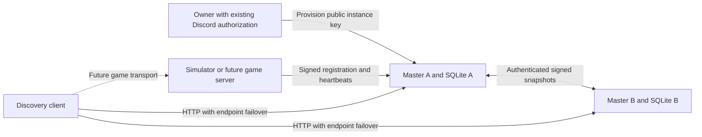

# Directory architecture

## Repository evidence and scope

The port is C++20 with CMake. Existing authentication is in
`include/halo2/discord_login.hpp` and `src/discord_login.cpp`: browser PKCE sign-in,
Discord `/users/@me` verification, and an in-memory `DiscordIdentity` containing
the stable Discord subject. `src/frontend_state.cpp` consumes that verified identity.
There is no existing web backend, database, or persistent player UUID to reuse.
The access token is local to the login worker and is discarded after verification.

The native LAN session in `include/halo2/multiplayer_network.hpp` and
`src/multiplayer_network.cpp` is a separate, incomplete gameplay transport. Its
packets and authority model are untouched by this directory work. The native
ONLINE frontend now has a read-only directory browser; it does not join games.
No retail or Xbox Live packet compatibility is claimed.

Python 3.13+ is used for a small independent daemon and CLI. `aiohttp` supplies
bounded asynchronous HTTP and TLS; `cryptography` supplies Ed25519; Python's
SQLite driver supplies durable local storage. Each master runs one process and
one event loop. Database operations are synchronous, bounded by the initial
capacity, and execute in transactions without an `await` inside a transaction.
Do not run multiple workers against the same state directory. Masters share
signed records, not a database. No Redis, consensus cluster, or cloud service is
required.

## Responsibilities

The directory owns enrollment, authorization, listing leases, discovery, and
federation. It never queries an advertised game endpoint, accepts gameplay
packets, reserves player slots, or relays players' traffic. A `players` count is
server-supplied information, not a reservation or a trustworthy match result.

## Distinct identities

| Identity | Representation | Authority and lifetime |
|---|---|---|
| Player | Existing verified Discord subject in the native client | Discord; no new player account system |
| Server owner | Opaque UUID mapping to `(provider, subject)` in the origin's SQLite database | Stable at that master; Discord subject remains private |
| Server instance | UUIDv5 derived from a dedicated Ed25519 public key | One key and persisted sequence per instance; independent of IP and screen name |
| Master | UUIDv5 derived from its Ed25519 public key | Persisted key plus database; peers pin both ID and key |

Owner UUIDs are local to an origin, not a global player UUID. Clients must treat
`(origin_master_id, owner_id)` as the owner reference. The same Discord owner can
have different opaque UUIDs at different masters. Screen names remain player
choices and are never authorization keys. No Discord ID is returned by public
discovery or federation.

Instance UUID: UUIDv5 using the standard URL namespace and ASCII name
`halo2-server:` followed by the lowercase 64-character public-key hex. Master
UUID uses `halo2-master:` instead. The CLI generates these automatically.

## Native integration seam

The [native ONLINE browser](native-discovery.md) now consumes anonymous
discovery through `OnlineDirectory` and configurable HTTPS master origins.
It retains the Discord menu gate, expires cached results locally, cancels on
exit/sign-out and offers metadata inspection without gameplay admission.
This is separate from the owner-provisioning seam below and the now-connected
[authenticated native matchmaking API](matchmaking.md).

Keep the existing PKCE flow, scopes, and identity checks. A future provisioning
action can pass the already obtained `access` token from the login worker to
`POST /v1/credentials/challenge` over a configured trusted HTTPS origin using its private in-memory authorization handoff. Send the instance public key and requested credential lifetime, sign the returned enrollment payload with the instance private key, then submit it as `proof` to `POST /v1/credentials` with the same fields and authorization. The
backend verifies the token's application ID, `identify` scope, and Discord
subject itself; it must never trust a subject asserted by the client.

Native owner provisioning is documented but not connected. Matchmaking already
uses that existing authorization handoff for its own independently verified
player session. After token expiration, reuse the existing sign-in flow.
No token, client secret, or Discord password belongs in server configuration.
The CLI's `--discord-token-stdin` accepts an existing token for integration use;
it does not launch or duplicate authentication. Operator bootstrap is available
for simulations and is explicitly disabled in the production Compose service.

The enrolled instance keeps its private key, credential ID, origin, expiry, and
monotonic request sequence in one mode-0600 file. It can restart without Discord
until the credential expires or is revoked. The owner provisions a fresh
instance key to replace an expired/revoked credential in v1; renewal with the
same instance key is not implemented.

## Future service interfaces

| Consumer | Stable directory boundary | Separate work still needed |
|---|---|---|
| Native server browser (connected) | `/v1/servers`, `expires_at`, configurable HTTPS master list | Game-version compatibility policy and gameplay joining |
| Dedicated server | Enroll public key, signed metadata/heartbeat/unregister lifecycle | Actual game process, transport, endpoint measurement |
| Native matchmaking (connected) | Discord-verified solo sessions, stored per-playlist skill, queue API, Quickmatch/Optimatch/Playlists and progress UI | Authenticated party membership, measured connectivity, allocation and authoritative results |
| Friends, parties, clans | Existing verified identity and a future global player mapping | Social database, membership/roles, invites, presence and privacy |
| Rankings | No authoritative input from this directory | Verified match reporting and competitive rules |
| Future transport | Advertised host and port plus `reachability: unverified` | Direct UDP, handshake, NAT traversal and optional probes |

Discovery cannot perform UDP hole punching. That requires cooperation from the
eventual game client/server transports and a separately specified rendezvous
protocol. The example endpoint is documentation-only and no Halo 2 connection
can be made to it.

## Required original Halo 2 matchmaking fidelity

User requirement: future playlists, both casual and ranked, must match people
with the same logic as original Halo 2 so the types of matches are faithful to
the original. Treat this as an acceptance requirement, not a later tuning
preference. The directory does not implement or imply a matching algorithm.

The [coordinator core](matchmaking.md) now implements evidence-based mechanisms
and explicitly labeled reconstruction policy. [Primary-source research](halo2-matchmaking-evidence.md)
includes Max Hoberman's public explanations, Bungie's GDC2005 presentation and
contemporary Bungie articles. The user's updated requirement permits best-effort
reproduction from public information where code is absent; unverified coefficients
must still be identified, not presented as recovered original behavior.

Before enabling original playlists, establish evidence for the relevant
original playlist definitions and matching rules from original source/assets,
decompiled routines, original developer explanations or verified original
behavior. This includes whichever
party, skill/rank, team formation, connection, search expansion, and playlist
eligibility rules the original evidence actually establishes. Document the
reference version/playlist era and build repeatable comparison scenarios for
casual and ranked queues. Do not substitute a modern generic matchmaking
algorithm or assume all original server-side rules can be reconstructed from client
code. Unknown weights/thresholds may use declared best-effort policy, with their
limitations documented. Clan/party/social systems must not
silently change those matching semantics.

## Reference boundary

[Project Reclaimer's public master-server documentation](https://projectreclaimer.dev/masters)
describes signed listings and multiple gossiping masters; that is the
architectural reference. Its source is not available in the public releases
repository. This implementation has its own API, trust model, and signatures;
it does not interoperate with Reclaimer. Reclaimer's
[project documentation](https://projectreclaimer.dev/) also excludes native
matchmaking. This project's matchmaking core is independent work; native
menu/solo-queue integration is now connected; gameplay admission, authenticated
party membership and clan services remain unfinished.
